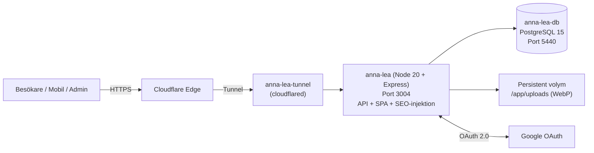
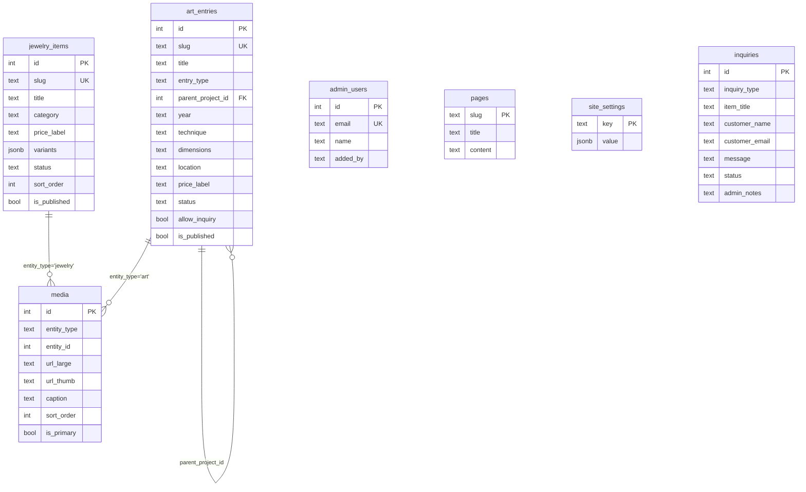

# Designdokument – Nya anna-lea.com

**Version:** 1.0  
**Syfte:** Visuell och teknisk beskrivning av den nya webbplatsen **anna-lea.com** (Smycken & Konst av Anna-Lea Öquist).

---

## 1. Översikt & Mål

Nya **anna-lea.com** ersätter den tidigare Wix-webbplatsen med en egenägd, snabb, lättunderhållen och mobilanpassad lösning som:

- Bevarar den avskalade, ljusa och konstnärliga känslan från den ursprungliga sajten.
- Lyfter fram både **Smycken** (kollektion + unika vigselringar) och **Konst** (enskilda verk + projekt/serier).
- Ger administratörer full kontroll över innehåll, förfrågningar, behörigheter samt **utseende & sidindelning** utan programmering.
- Driftas inledningsvis på **HP ZBook (Ubuntu Server / Docker / Portainer / Cloudflare Tunnel)** i linje med övriga egna appar (`fagelloggen`, `fishing-log`, `city-packman`, `city-history-map`), men är förberedd för enkel flytt till valfri molntjänst.

---

## 2. Visuell design & Formsåk

### Estetisk grund
Utformningen bygger på den ursprungliga anna-lea.com-profilen: generösa vita ytor, skarp men mjuk kolgrå typografi, tunna 1 px-avgränsare och fullt fokus på fotografier av hantverk och konst.

### Standardpalett (CSS-variabler, ändringsbara i `/admin`)
| Roll | CSS-variabel | Standardvärde | Användning |
| :--- | :--- | :---: | :--- |
| Huvudbakgrund | `--color-bg-primary` | `#FFFFFF` | Sidbakgrund och galleriyta |
| Sekundär yta | `--color-bg-secondary` | `#FAF9F7` | Sidfot, formulärrutor, avdelare |
| Primär text | `--color-text-primary` | `#2F2E2E` | Rubriker, navigering, primära knappar |
| Sekundär text | `--color-text-muted` | `#605E5E` | Brödtext, metadata, diskreta länkar |
| Accentfärg | `--color-accent` | `#8C6D5A` | Hover-markeringar, citatkant |

### Typografi
- **Standard:** `Jost` (vikt 200–400) — fri, öppen geometrisk sans-serif med samma lätta känsla som originalets *Futura Light / DIN Next Light*.
- **Valbara alternativ i admin:** `Raleway` (luftig sans-serif), `Cormorant Garamond` (konstnärlig serif) och `Georgia` (klassisk serif).
- **Rubrikstil:** Versaler med generös spärrning (`tracking-[0.16em]`–`0.25em`) och lätt vikt (`font-light`).

### Signaturgrafik
- **Logotyp & favicon:** Den cirkulära grötdocka-silhuetten (`/favicon.png`).
- **Stämningsbild (standard-hero):** Originalets varma bild med prismaljus på hud (optimerad WebP), utbytbar i `/admin` med steglös mörkläggning (`heroOverlayOpacity`) för säker läsbarhet.

---

## 3. Systemarkitektur

Applikationen körs som en enda lättvikts-container för både API och statisk React-frontend, tillsammans med PostgreSQL och Cloudflare Tunnel.

### Teknikval
- **Frontend (`client/`):** React 19, Vite 6, Tailwind CSS 3, React Router 7, Lucide-ikoner.
  - Admingränssnittet (`/admin`) laddas med `React.lazy` så att publika besökare inte laddar ner admin-koden.
  - Dynamiskt tema appliceras vid sidladdning via `SiteContext` → CSS-variabler på `:root`.
- **Backend (`server/`):** Node.js 20 (ESM), Express 4, `pg`, `sharp`, `multer` v2, `helmet`, `express-rate-limit`, `google-auth-library`, `jsonwebtoken`.
  - **SEO & delning:** Vid sidbegäran i produktion injicerar `server/services/seo.js` dynamisk `<title>`, `<meta description>` och Open Graph-taggar (`og:title`, `og:description`, `og:image`) i `index.html` för smyckes- och konstsidor.
- **Databas:** PostgreSQL 15 (`postgres:15-alpine`), med idempotent schemainitiering (`server/db/schema.sql`) vid uppstart.

---

## 4. Informationsarkitektur & Rutter

| Rutt | Beskrivning |
| :--- | :--- |
| `/` | Startsida – styrs av `layout.homeMode`: *Gemensam startsida* (standard med hero, Smycken/Konst-ingångar och presentation), eller direktvisning av *Smycken* / *Konst*. |
| `/smycken` | Smyckeskollektion, sektionen *Unika beställningar / Vigselringar* samt *"Min syn på smycken"*. |
| `/smycken/:slug` | Detaljsida med flerbildsgalleri, helskärms-lightbox, val av prisvariant samt beställnings-/förfrågningsformulär. |
| `/konst` | Galleri med filter (*Alla / Projekt & serier / Enskilda verk*) samt *"Om konsten"*. |
| `/konst/:slug` | Detaljsida med galleri/lightbox, enbart ifyllda metadatafält, ev. ingående verk i ett projekt samt intresseförfrågan. |
| `/info/:slug` | Redigerbara informationssidor (*Beställning och storlek*, *Returer*, *Allmänna villkor*). |
| `/kontakt` | Kontaktuppgifter, ateljéadress på Södermalm och kontaktformulär. |
| `/admin` | Google OAuth-skyddat, mobilanpassat admingränssnitt. |

---

## 5. Datamodell (PostgreSQL)

---

## 6. Bildhantering & Prestanda

- **Uppladdningspipeline (`server/services/imageProcessor.js`):**
  1. `multer` tar emot upp till 10 bilder per uppladdning i minnet (max 25 MB/fil, endast `image/*`).
  2. `sharp` läser EXIF-orientering (`.rotate()`) så stående mobilfoton alltid blir rättvända.
  3. Två WebP-filer skapas:
     - **Thumbnail (`*-sm.webp`):** max 640 px bred (kvalitet 80) för snabba gallerier.
     - **Fullvy (`*-lg.webp`):** max 1800 px bred (kvalitet 84) för detaljvy och lightbox.
- **Caching:** `/uploads/*` serveras med `Cache-Control: public, max-age=31536000, immutable` eftersom varje uppladdning får ett unikt filnamn.
- **Lazy loading:** Galleribilder använder `loading="lazy"` och admin-modulen code-splittas med `React.lazy`.

---

## 7. API-översikt

| Område | Endpoints | Skydd |
| :--- | :--- | :--- |
| Hälsa | `GET /api/health` | Publik |
| Auth | `GET /api/auth/google`, `GET /api/auth/callback`, `GET /api/auth/me`, `POST /api/auth/logout` | Rate-limit |
| Publikt | `GET /api/public/bootstrap`, `GET /api/public/jewelry(/:slug)`, `GET /api/public/art(/:slug)`, `GET /api/public/pages/:slug` | Publik + Rate-limit |
| Förfrågningar | `POST /api/public/inquiries` | Rate-limit (10/15 min) + honeypot |
| Admin | `/api/admin/{stats, jewelry, art, media, pages, settings, inquiries, users}` | `requireAdmin` (JWT-cookie + live DB-vitlista) |

---

## 8. Säkerhet

- **Autentisering:** Ren Google OAuth 2.0. Sessionscookie (`anna_lea_auth`) är `HttpOnly`, `SameSite=Lax` och `Secure` i HTTPS/produktion.
- **Realtidsåterkallelse:** `requireAdmin` verifierar inte bara JWT-signaturen utan kontrollerar vid varje anrop att e-postadressen fortfarande finns i `admin_users` (eller `INITIAL_ADMIN_EMAIL`).
- **Skydd mot missbruk:** `helmet` (CSP & säkerhetsheaders), strikt CORS-lista (`FRONTEND_URL` + betrodda domäner), `express-rate-limit` och osynligt honeypot-fält på alla publika formulär.
- **SQL-injektion & XSS:** Alla databasfrågor använder parametriserade PostgreSQL-frågor (`$1, $2, ...`), och SEO-injektionen HTML-escapar all dynamisk data.

---

## 9. Drift på ZBook & Molnflytt

### Port- och resursallokering (krockfri på ZBook)
- **App:** `3004` (`anna-lea`)
- **PostgreSQL:** `5440` (`anna-lea-db`, rymmer både `annalea_prod` och `annalea_dev`)
- **Vite dev:** `5176`
- **Nätverk:** `anna-lea-net`
- **Host-volymer på ZBook:** `/home/anders/srv/anna-lea/uploads` och `/home/anders/srv/anna-lea/db` (styrbara via `.env`).

### Flytt till molntjänst (t.ex. Railway, Render, Fly.io eller VPS)
1. Peka `DATABASE_URL` mot valfri hanterad PostgreSQL-tjänst (Neon, Supabase, Railway m.fl.).
2. Bygg och kör befintlig `Dockerfile` (ingen ZBook-specifik kod finns i appen).
3. Sätt `FRONTEND_URL`, `AUTH_REDIRECT_URI` (samt motsvarande callback-URL i Google Cloud Console), `GOOGLE_CLIENT_ID`, `GOOGLE_CLIENT_SECRET`, `JWT_SECRET` och `INITIAL_ADMIN_EMAIL`.
4. Om molntjänsten saknar persistent disk, byt endast ut lagringsfunktionerna i [server/services/storage.js](file:///c:/Users/Windows/OneDrive/Dokument/AI%20Projekt/anna-lea/server/services/storage.js) mot t.ex. Cloudflare R2 eller AWS S3 — resten av applikationen förblir oförändrad.
